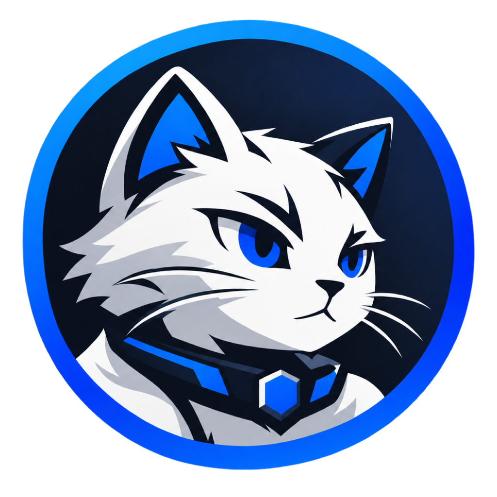
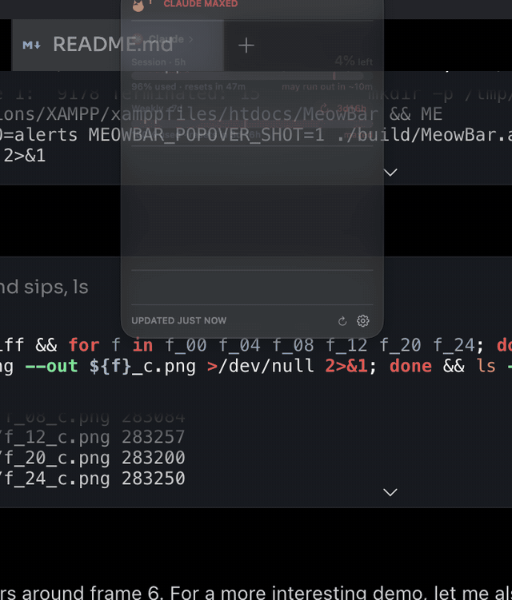

<p align="center"></p>

<h1 align="center">MeowBar</h1>

<p align="center"><strong>Your AI limits, at a glance.</strong></p>

<p align="center">
  How much Claude Code and Codex you have left — before the wall, not after.<br>
  A tiny cat in the menu bar that reads the credentials your tools already store.
</p>

<p align="center">
  
  
  
  
  
</p>

<p align="center">
  <a href="https://github.com/debugged-me/MeowBar/releases/latest/download/MeowBar.dmg"><strong>Download for macOS</strong></a>
  · <a href="#getting-started">Getting started</a>
  · <a href="https://github.com/debugged-me/MeowBar/issues">Report a bug</a>
</p>

> **macOS 14+ · Apple Silicon · v1.3.** The app is **ad-hoc signed** —
> macOS will warn once on first launch: right-click → **Open**, or
> System Settings → Privacy & Security → Open Anyway.
> [Build from source](#build-and-run)

[What it shows](#what-it-shows) | [Install](#install) | [Make it yours](#make-it-yours) | [Tips](#tips) | [Troubleshooting](#troubleshooting)

<p align="center">
  
</p>

## Why

Claude and Codex rate-limit you on hidden 5-hour and weekly windows — and you
only find out when the wall hits. MeowBar puts those numbers where they belong:
always visible, always fresh, zero setup. No accounts, no API keys — it reads
the credentials your CLI tools already stored on your Mac (Keychain for Claude,
`codex app-server` for Codex) and calls the same usage endpoints they do.

## Install

| Platform | Availability |
| --- | --- |
| macOS 14+, Apple Silicon | [Download v1.3](https://github.com/debugged-me/MeowBar/releases/latest/download/MeowBar.dmg) |
| Homebrew | `brew tap debugged-me/meowbar` → `brew trust debugged-me/meowbar` → `brew install --cask meowbar` |
| Intel Macs | Not supported (Apple Silicon only) |

1. [Download MeowBar.dmg](https://github.com/debugged-me/MeowBar/releases/latest/download/MeowBar.dmg), open it, drag **MeowBar** to **Applications**.
2. Launch it — macOS warns once since it's ad-hoc signed:
   right-click → **Open** (or System Settings → Privacy & Security → Open Anyway).
3. Allow the one-time **Keychain prompt** (choose *Always Allow*) so it can read
   your Claude credentials. Codex needs no prompt.

You need to be signed in to `claude` and/or `codex` on that Mac. Claude needs a
Pro/Max subscription login — pure API-key users have no OAuth credential to read.
A third provider, Devin, appears automatically when the Devin IDE is signed in
and hides entirely otherwise.

## What it shows

- 🐱 **The bar talks.** Brand icons plus % left per provider, turning into short
  status words (`running`, `task done`, `nearing limit`, `limit reached`) that
  clear themselves. Right-click for a proper menu — Refresh, Settings, Quit.
- 👀 **A glance hierarchy.** One line up top says the worst news first (`ALL
  QUIET`, `CLAUDE MAXED`, `2 AGENTS WORKING`). `% left` is the hero number; when
  a window maxes, it becomes a live reset-countdown chip — because that's the
  only number you need then.
- ⏳ **Pace, not just points.** Every bar carries an even-pace tick (fill past it
  = ahead of pace) and a colored verdict — `plenty left`, `comfortable`,
  `cutting it close`, `may run out in ~2d` — silent until there's enough signal.
- 📈 **History.** Click a provider's name for its last 7 days, its busiest
  hours, and a 24h burn sparkline. Right-click a provider to copy a one-line
  summary. Kept locally for 8 days.
- 🔔 **Alerts that respect you.** Notifications at 75 / 90 / 95% and on window
  reset, each toggleable; near a limit they point at the other tool if it has
  headroom ("Codex has 70% left"). The item flashes instead of yelling.
- 🐈 **A cat.** Naps when nothing's running, trots while an agent works,
  startles near a limit, celebrates a fresh reset. Holds still under Reduce
  Motion — and only animates while the popover is actually open.
- 🪶 **Featherweight.** Native Swift, ~100 MB RAM, 0% CPU idle. Idle polling
  drops to every 2 minutes when nothing is running.

### Never stale, never blank

Last-good numbers are cached on disk — a relaunch or rate limit shows them with
their age instead of an error. Repeated 429s back off exponentially. When the
Claude token expires, MeowBar launches `claude` briefly so it renews itself, and
error states carry action buttons (`Run codex login in Terminal`, `Open Devin`).

### Always-fresh Claude

Optionally, Claude Code pushes its limits through its status line after every
message — zero polling, no rate-limit delays (Settings → Claude → Always fresh).
And since Claude's 5-hour window only opens on your first message, MeowBar can
send a one-word Haiku prompt while you're at the Mac so the reset clock starts
sooner (Settings → Claude → Start the 5h clock).

## Make it yours

| Setting | What it does |
| --- | --- |
| **Position** | Right with the other icons, or a floating "island" centered under the notch — the island gets a cat mark and a hairline tinted by your worst window |
| **Show** | `% left`, `time until reset`, or `time until empty` — the last one is pace-projected (`~2h` means you'd hit the cap in about 2 hours) |
| **Compact** | Collapses the bar to a single cat silhouette tinted by your worst window — gray calm, orange near a limit, red at the wall |
| **Trot** | A small cat bob in the menu bar whenever an agent is running (off by default — the bar stays perfectly still) |
| **Open MeowBar with** | A global hotkey (⌃⌥M by default) to pop it from anywhere |
| **Alerts** | Four independent toggles: 75%, 90%, 95%, and window reset |
| **Sounds** | Optional: a mew when a limit resets, a soft purr when a task finishes — both off by default |
| **Launch at login** | One toggle, no Login Items digging |

In the popover: `r` refreshes, `1`/`2`/`3` toggle a provider's history, `,`
opens Settings, `q` quits, and any other key politely dismisses it. The gear
menu holds About, Settings, update actions and Quit. Right-click the bar itself
(or the island) for the same menu — and right-click a provider row to copy its
numbers.

## Tips

- **Scriptable** — `MeowBar.app/Contents/MacOS/MeowBar --json` prints the cached
  numbers; drop it into a shell prompt or a status bar widget.
- **Tooltip** — hover the bar item for the full breakdown without clicking.
- **Update check** — once a day against the latest GitHub Release; a red dot
  appears on the gear when a new version is out.
- **Keyboard-only** — the whole popover works without touching the mouse.

## Troubleshooting

- **"MeowBar can't be opened"** — it's ad-hoc signed. Right-click → Open once.
- **Stale clock icon next to a provider** — a transient failure (rate limit,
  network); it shows the last good numbers and keeps retrying.
- **Codex shows a sign-in error** — run the suggested `codex login` action;
  the button in the popover opens Terminal with it typed for you.
- **No Claude data** — make sure `claude` is signed in with a Pro/Max
  subscription, not just an API key.

## Privacy

No analytics, no telemetry, no accounts. The only network calls are the same
usage endpoints your CLI tools already hit, plus one daily update check.
Credentials never leave the keychain paths macOS already protects.

## Build and run

```sh
./build.sh   # → build/MeowBar.app + build/MeowBar.dmg (+ ./MeowBar.dmg, ./version.json)
swift test   # unit tests for the pure logic in MeowBar/Sources/Core
```

Plain `swiftc` — no Xcode project, no dependencies. `Package.swift` exists only
for the tests. Signing is ad-hoc by default; with an Apple Developer ID:

```sh
xcrun notarytool store-credentials meowbar          # once
MEOWBAR_SIGN_ID="Developer ID Application: Your Name (TEAMID)" \
MEOWBAR_NOTARY_PROFILE=meowbar ./build.sh            # signed, notarized, stapled DMG
```

To ship an update: bump `CFBundleShortVersionString` in `Info.plist`, then
`git tag vX.Y && git push --tags` — CI builds and attaches the DMG +
`version.json` to the GitHub Release, which the in-app update check reads.

<details>
<summary><strong>For developers — file map & dev tools</strong></summary>

```
MeowBar/Sources/main.swift            app, menu bar icons, island panel, alerts, store
MeowBar/Sources/UsageService.swift    credentials, providers, statusline bridge, session clock
MeowBar/Sources/PopoverView.swift     popover UI, status header, history strip, cat, gear menu
MeowBar/Sources/CatGlyph.swift        the cat silhouette — one vector mark, tinted everywhere
MeowBar/Sources/PopoverShot.swift     MEOWBAR_POPOVER_SHOT — float the popover for screenshots
MeowBar/Sources/SettingsView.swift    settings window
MeowBar/Sources/OnboardingView.swift  first-launch window (with a menu-bar mock)
MeowBar/Sources/AppSupport.swift      on-disk cache/history, --json, update check
MeowBar/Sources/HotKey.swift          global shortcut
MeowBar/Sources/Core/                 pure logic (models, pace, history, clock) — unit-tested
Tests/MeowBarCoreTests/               swift test
MeowBar/Sources/statusline/main.swift meowbar-statusline helper (Claude bridge)
index.html                            landing page (self-contained, pairs with MeowBar.dmg)
```

Tip: `MEOWBAR_DEMO=alerts MEOWBAR_POPOVER_SHOT=1 ./MeowBar.app/Contents/MacOS/MeowBar`
floats a canned-data popover mid-screen for fresh screenshots (`preview.png`
came from that). Add `MEOWBAR_EXPAND=1` to open a provider's history.

</details>
