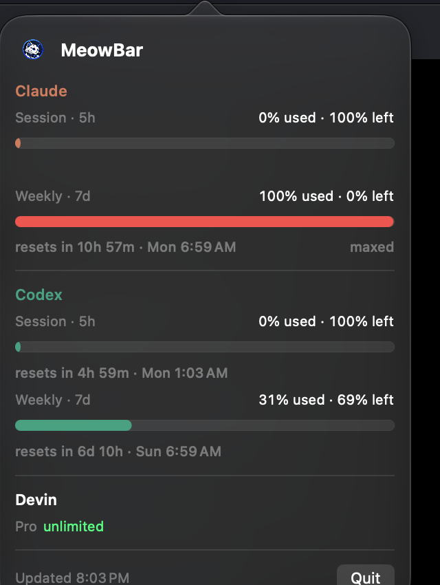

# MeowBar

Your AI usage, at a glance — a tiny native macOS menu bar app that shows how much
of your **Claude Code** and **Codex** limits you have left.



## Why

Claude and Codex rate-limit you on hidden 5-hour and weekly windows. MeowBar puts
those numbers where they belong: always visible, always fresh, zero setup.

## Features

- **No accounts, no API keys** — reads the credentials your CLI tools already
  stored on your Mac (Keychain for Claude, `~/.codex/auth.json` for Codex)
- **Menu bar glanceability** — per-provider % remaining; turns into short status
  words (`running`, `task done`, `nearing limit`, `limit reached`) that auto-clear
- **Popover detail** — session + weekly bars in brand colors, reset countdowns,
  pace warnings (`maxed`, `expected out in …`), last-updated timestamp
- **Optional third provider** — shows Devin quota too if the Devin IDE is signed
  in on that Mac; hidden entirely otherwise
- **Smart** — refreshes every 30s, self-throttles on HTTP 429 via `Retry-After`,
  detects when a CLI is actively working
- **Polite** — Liquid Glass popover, dismisses on any key or outside click
- **Persistent** — launches at login
- **Featherweight** — native Swift, ~100 MB RAM, 0% CPU idle

## Install

1. Download `MeowBar.dmg`, open it, drag **MeowBar** to **Applications**
2. Launch it — macOS warns once since it's ad-hoc signed:
   right-click → **Open** (or System Settings → Privacy & Security → Open Anyway)
3. Allow the one-time **Keychain prompt** (choose *Always Allow*) so it can read
   your Claude credentials

## Requirements

- macOS 14+, Apple Silicon
- Signed in to `claude` and/or `codex` on that Mac (Claude needs a Pro/Max
  subscription login — pure API-key users have no OAuth credential to read)

## Privacy

No analytics, no telemetry, no accounts. The only network calls are the same
usage endpoints your CLI tools already hit. Credentials never leave the keychain
paths macOS already protects.

## Build

```sh
./build.sh   # → build/MeowBar.app + build/MeowBar.dmg (and ./MeowBar.dmg for the site)
```

Single `swiftc` invocation — no Xcode project, no dependencies.

## Files

```
MeowBar/Sources/main.swift          app, menu bar, popover shell, alert engine
MeowBar/Sources/UsageService.swift  credential reads + provider HTTP calls
MeowBar/Sources/PopoverView.swift   popover UI
index.html                          landing page (self-contained, pairs with MeowBar.dmg)
```
